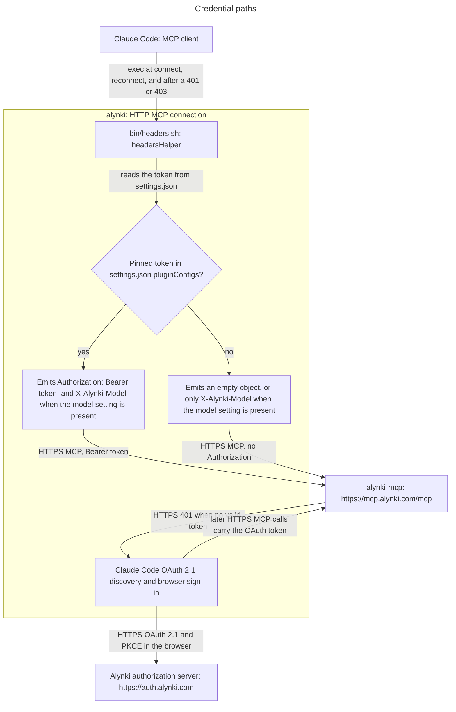
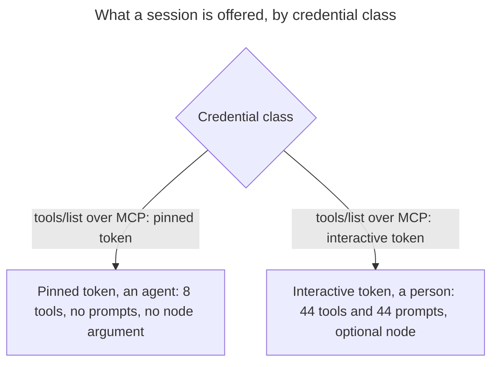
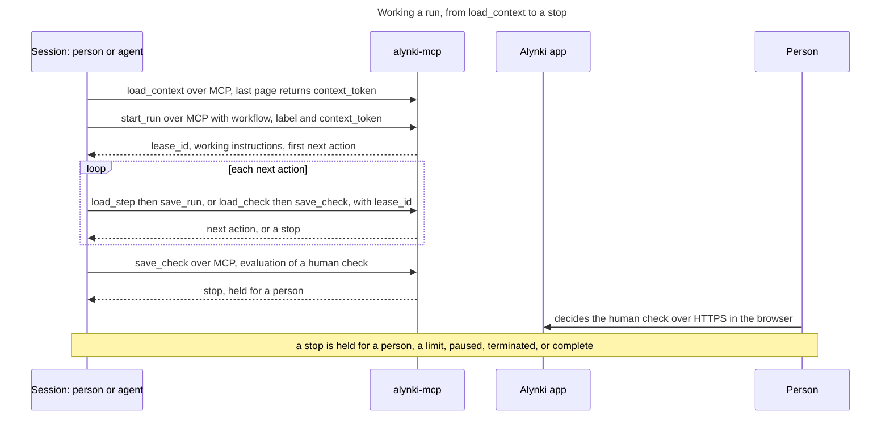

# Alynki plugin

From your people to your customers, faster and with higher quality. Alynki is the business context layer your people and their AI agents work from. AI doesn't replace your people, it empowers them.

Alynki requires an Alynki account. Request access at alynki.com/contact. Setup and examples: alynki.com/docs.

To start in Claude Code, run `/plugin marketplace add alynki/plugin` and then `/plugin install alynki@alynki-marketplace`. The connection is bundled, so no other step is needed, and you sign in with your own identity the first time you use Alynki (*Install*).

This is the plugin for Alynki in Claude Code, Codex CLI and Antigravity CLI. It loads your organisation's context into every session: the policy and product context for the scope your credential holds and, where that scope sits in a workflow, the steps, checks and runs that define how the work is done. Alynki delivers to a principal only what that principal is granted; it does not constrain what an agent obtains from other sources.

One plugin ships from this marketplace: **`alynki`**.

## Repository layout

- [`.claude-plugin/marketplace.json`](.claude-plugin/marketplace.json): the marketplace
  `alynki-marketplace`, listing the plugin.
- `alynki-plugin/` (`alynki`): an HTTP MCP connection, the `bin/headers.sh` header helper, the
  session hooks and the [`setup` skill](alynki-plugin/skills/setup/SKILL.md).
- `copilot/`: the sources and the build of the Microsoft 365 Copilot agent package, a zip (see
  [Microsoft 365 Copilot](#microsoft-365-copilot)). It is not part of `alynki-plugin/`.

## Credential paths

There are two paths: sign in with your own identity, or hold a pinned token. A pinned token always
wins when both are present.



Key: rectangle, a process or message; diamond, a decision; the boxed group is the plugin.

A static `headers.Authorization` key in `.mcp.json` would disable Claude Code's OAuth fallback
unconditionally, even when its value is empty, so the plugin decides at connection time
with a `headersHelper` script. The script reads the token with `jq`; without `jq` on `PATH` it emits
no header and the session signs in instead. The same script sends the session's model as a second
header (see *The model header*). An agent working a run unattended has one credential,
the one its controller issues it, and never sees a sign-in prompt.

## Install

```
/plugin marketplace add alynki/plugin
/plugin install alynki@alynki-marketplace
```

That is the whole install: **the MCP connection is bundled**, with no `claude mcp add` step.

### Codex CLI

Codex reads the same plugin folder (`alynki-plugin/`): its `.codex-plugin/plugin.json` names `mcp.json` and its own hook file, `hooks/codex-hooks.json` (the `codex` shape of `session-start.sh`, which prints `additionalContext` only). Install it with `codex plugin marketplace add alynki/plugin` and `codex plugin add alynki@alynki-marketplace`, then sign in when Codex first connects to `https://mcp.alynki.com/mcp`. Codex runs a plugin's hooks only once you have reviewed and trusted them in Codex (it skips them until then), so the session-start instruction starts after that one-time trust, and does not run from the public plugin directory. Without the hook, ask your agent to call `load_context` first, or rely on the server's own instructions.

### Antigravity CLI

```
agy plugin install https://github.com/alynki/plugin
```

Antigravity reads `alynki-plugin/.antigravity-plugin/plugin.json`, `mcp_config.json` and `hooks.json`. If your version expects the plugin at the repository root, install from a local clone's `alynki-plugin/` folder instead: `agy plugin install <path>/alynki-plugin`. Sign in when Antigravity first connects. Run `agy plugin validate ./alynki-plugin` to check the folder; its warnings about `.mcp.json`, `mcp.json` and `hooks/hooks.json` are expected, since those files are for the other clients.

### VS Code (GitHub Copilot)

Turn on the `chat.plugins.enabled` setting, then run "Chat: Install Plugin from Source" from the Command Palette and enter `alynki/plugin`.

### GitHub Copilot CLI

```
copilot plugin marketplace add alynki/plugin
copilot plugin install alynki@alynki-marketplace
```

Copilot reads the root `plugin.json` (Copilot format), which names `hooks/copilot-hooks.json` (the `sessionStart` and `subagentStart` hooks) and `copilot-mcp.json` (the same address). Antigravity keeps the fixed root `hooks.json`, so the Copilot hooks sit in their own file. Sign in when the client first connects. Agent hooks in VS Code and Copilot CLI are in preview, and the instruction only runs where your organisation allows plugins and hooks: the VS Code policies `ChatPluginsEnabled`, `ChatAllowManagedHooksOnly` and `ChatStrictMarketplaces` can block either. Without the hook, ask your agent to call `load_context` first.

### Grok (Grok Build and grok.com)

Grok reaches Alynki as a remote MCP connector at `https://mcp.alynki.com/mcp`; sign in when it first connects. Grok Build's session-start hooks only observe, so the plugin ships no hook for it. Add this one line to the global `~/.grok/AGENTS.md` (not a working-directory file, and not a file Codex also reads):

```text
Before anything else in every session and subagent, call Alynki's load_context, and page it to completion.
```

grok.com reads the connector's server instructions, which already name `load_context` first.

### ChatGPT

Add Alynki as a connector (Settings, Apps and connectors, a custom connector at `https://mcp.alynki.com/mcp`) and sign in. ChatGPT has no session-start hook; the connector's server instructions tell a new chat to call `load_context` first.

### Every client

A session starts with `load_context`: the hook (Claude Code, Codex, Antigravity, VS Code and Copilot CLI) tells the session, and in Claude Code every subagent, to call Alynki's `load_context` first, and the server's own instructions say the same everywhere else. The hooks are one script, `alynki-plugin/hooks/session-start.sh`, printing one wording file, `alynki-plugin/hooks/load-first.md`, in each client's output shape. Grok Build has no hook that can inject text, so it ships none: the line in `~/.grok/AGENTS.md` above does it.

**To sign in with your own identity**, install and use it; run `/mcp` to sign in when prompted.

**If you hold a pinned token**, one your operator issued, put it in the plugin's **Alynki API token**
field (`/plugin`, or `--config token=…` on install). The token is stored in `settings.json`, where
`headers.sh` reads it. Unattended automation never signs in, since sign-in needs a human in a
browser.

⚠️ **The Alynki app shows no agent token** (no "Show token"; an agent has none to reveal): an agent
works only through the credential a controller is issued, so there is nothing to copy from the app
into this field. A token revealed before V2.5.2 was retired; if one is still in the field, the
server answers 401 `token not recognised`. Clear the field and sign in with `/mcp`.

### The model header

An optional setting, **`model`**, sits beside the token in the plugin's configuration. When it is
set (for example `claude-sonnet-5-5`), `bin/headers.sh` sends it with every call as the second
header, **`X-Alynki-Model`**, next to `Authorization`; when it is absent or is not a plain model id
(letters, digits, `.`, `_`, `:`, `-`, at most 100 characters, no leading `-`), **no model header is
sent**. The model is never printed: the script's only output is the header JSON Claude Code
consumes. A controller that launches a session on a chosen model writes the setting into that
session's private settings; a person's own session leaves it blank and sends none. The header is a
consistency control, not a boundary: a call without it is not checked by the server.

## Environment variables

Every variable the plugin reads, and where:

- `CLAUDE_CONFIG_DIR`: where Claude Code keeps `settings.json`. The plugin's
  `bin/headers.sh` reads the pinned token and the model setting from
  `$CLAUDE_CONFIG_DIR/settings.json`, and from `~/.claude/settings.json` when it is unset.
- `CLAUDE_PLUGIN_ROOT`: set by Claude Code to the installed plugin's directory; the plugin's
  `.mcp.json` uses it to locate `bin/headers.sh`.

## What it installs



Key: diamond, a decision made by the server; rectangle, the surface a session is offered.

- **Pinned** (agent) credentials, including one working a run unattended, are offered exactly
  **eight tools**: `load_context`, `save_context`, `start_run`, `load_run`, `load_step`,
  `load_check`, `save_run` and `save_check`. `load_context` and `save_context` take **no node
  argument**: scope comes entirely from the token. The run tools take labels: `start_run` and
  `load_run` a `workflow` and the run's `label`; `load_step` and `load_check` a `workflow`, the `run`
  and the `step` or `check`; `save_run` and `save_check` a `workflow`, the run's `label` and the
  `step` or `check`. `step` accompanies a `check` only when that check's label repeats under two
  steps. Outside a run, `load_step` and `load_check` read the template with `node`. No authoring,
  deletion, move, people or agent tool is served to a pinned credential: calling one is the refusal
  for a tool that does not exist.
- **Interactive** (human) credentials are offered all **forty-four** tools (the eight plus every
  other tool, among them `create_inherited_check`, `list_inherited_checks`, `load_inherited_check`,
  `move_inherited_check` and `delete_inherited_check`). Every tool but `start_run` has a typed slash
  prompt taking one whole-string argument, and the composite prompt **`work-run`** covers
  `start_run`: forty-four prompts. Prompts are never offered to a pinned credential.
- **Large context is paged** in 25 KiB pages: both credential classes read it with the optional
  `cursor` of `load_context`, `load_step` and `load_check`. Only an interactive session saves a large
  body in staged chunks (`mode` `stage`, then `commit`); a pinned `save_context` has no staged mode
  and takes the body whole. The eight list tools answer ten rows a page: narrow with `query`, `state`
  or `node` and follow `next_cursor`. The tool descriptions and prompts the server serves carry the exact rules for what each tool
  does, and for how confirm tokens, the run lease, the context token, run holds and non-composing
  reads work.
- `SessionStart` and `SubagentStart` hooks (Claude Code and Codex; Antigravity gets `SessionStart`) that
  instruct every session, and every subagent, to call `load_context` first. Each runs
  `hooks/session-start.sh`, which prints the one wording file `hooks/load-first.md` in the client's
  shape (Claude Code: `SessionStart` emits both `initialUserMessage` and `additionalContext`; Codex,
  from its own `hooks/codex-hooks.json`: `SessionStart` emits `additionalContext` only, because Codex drops
  an output carrying a field it does not know; `SubagentStart` emits `additionalContext` in both;
  Antigravity: an injected `systemMessage`). The text names only `load_context`, which every credential class holds.

## Working a run

A run (a workflow's steps and checks, in progress against one label) is worked the same way by a
person or an agent.



Key: solid arrow, a request; dashed arrow, a reply; the loop ends at a stop.

- **In an interactive session**, the `work-run` prompt takes the `workflow` and the `run`'s
  label and works the run to a stop. Unattended work runs through `alynki-controller`, a separate
  customer-side piece that embeds a copy of this plugin: it polls Alynki's controller API (never
  MCP, a different credential and surface) for ready runs and starts one headless session per run it
  reserves; that session calls `load_context` and `start_run` over MCP as an interactive one does.
- **A pinned session** gets a `context_token` from `load_context`'s last page, required by every
  run, step and check tool, and a `lease_id` from `start_run`, required by every write. Every write
  returns the next action or a stop; following it verbatim is the whole loop.
- **The trail is delivered once per lease.** `load_step` and `load_check` with a `run` return the
  whole trail of the run to the holder of the run's lease on its first load after `start_run`; every
  later load by the holder returns the step's or check's own text and one closing line saying the
  trail was already delivered, which is faster and uses far fewer tokens. `start_run` again, or
  `load_run`, returns the records again (after a compaction, for instance). A session that does not
  hold the lease gets the definition alone, and a save before the first load is refused with the
  call to make.
- **Each step output and check evaluation is saved with a reasoning.** `save_run` takes a
  `reasoning` with every `output`, and `save_check` with every `output`, a human check's included:
  one plain paragraph of 10 to 80 words saying why the work was done or the verdict reached, not
  the output restated. Nothing is saved without it, and the run's record prints it beside the output
  or evaluation.
- **A human check is decided in the app only, by a person, never over MCP**, by any credential.
  `save_check` records the evaluation and hands the run to a person; deciding it (`approved`) is
  refused and says so.
- **A revoked agent is kept, never deleted.** Its credential and every run record it left stay,
  shown as revoked in the Alynki app.

## After installing: grant standing permission

A plugin cannot pre-approve its own tool calls, and has no install-time hook. Left alone, each
session prompts for `load_context` the first time it runs, and accepting saves the grant to that
**repository only**; a session started anywhere else prompts again.

Run once, in any session:

```
/alynki:setup
```

It shows the edit, then adds to your own `~/.claude/settings.json`, machine-wide, one exact-name rule
in `permissions.allow` for each of 37 Alynki tools, and one exact-name rule in `permissions.ask` for
each of the seven that change who has access or manage the agents (`grant_principal`,
`revoke_principal`, `invite_principal`, `revoke_principal_invite`, `create_principal_agent`,
`update_principal_agent`, `revoke_principal_agent`). The seven ask a person before every call, so text
an agent reads (a node body, a run record) cannot steer an access change unseen. The
`plugin_alynki_alynki` segment is exact, so the rules can only match Alynki's own server. On a machine
set up by 0.29 it also removes the allow rules that version wrote for the seven.

The lists are two files, one tool name per line: [`alynki-plugin/tools.txt`](alynki-plugin/tools.txt)
(the 37 allowed) and [`alynki-plugin/ask-tools.txt`](alynki-plugin/ask-tools.txt) (the seven that
ask). Every setup reads them and none holds a copy. A tool the server adds later is covered once a
list gains it and the setup is run again.

⚠️ **This command still prompts once, for its own write.** `~/.claude` is a protected path, so no
allow rule suppresses that prompt. It removes every *subsequent* Alynki prompt, not its own.

To grant it by hand, add one `permissions.allow` entry per line of `tools.txt` and one
`permissions.ask` entry per line of `ask-tools.txt` to `~/.claude/settings.json`, keeping existing
entries:

```json
{
  "permissions": {
    "allow": [
      "mcp__plugin_alynki_alynki__load_context",
      "mcp__plugin_alynki_alynki__save_context"
    ],
    "ask": [
      "mcp__plugin_alynki_alynki__grant_principal"
    ]
  }
}
```

(Three entries shown; the real lists have 37 and 7.)

### Setup per client

| Client | Setup |
|---|---|
| Claude Code | `/alynki:setup`, above. |
| Antigravity CLI | `sh alynki-plugin/bin/setup-antigravity.sh` from a clone. It merges `mcp(alynki/<tool>)` rules for the 37 tools in `tools.txt` into `permissions.allow` of `~/.gemini/antigravity-cli/settings.json` and removes any allow rule for the seven in `ask-tools.txt`, so Antigravity asks before each of those; it keeps every other entry, and a second run changes nothing. Needs `jq`. Antigravity documents `mcp(server/*)` and `mcp(*)` wildcards too; the script writes the explicit list. |
| Codex CLI, VS Code, GitHub Copilot CLI | No local permission file is written here; approve per your client's own prompt. |
| ChatGPT, Microsoft 365 Copilot, grok.com | Approval is set in the product, not on this machine; see the documentation page at https://alynki.com/docs/. |

## What the plugin runs, sends and fetches

The plugin's own [README](alynki-plugin/README.md) lists everything it runs, sends or fetches,
including the one setting held in `settings.json` (*What it runs, sends and fetches*).

## Release notes

- `alynki` 0.30.0: `/alynki:setup` asks again before the seven access-changing tools (`grant_principal`,
  `revoke_principal`, `invite_principal`, `revoke_principal_invite`, `create_principal_agent`,
  `update_principal_agent`, `revoke_principal_agent`), reversing 0.29.0's allow-all: it allows the 37 tools in
  `alynki-plugin/tools.txt`, writes an exact-name ask rule for each of the seven in `alynki-plugin/ask-tools.txt`,
  and removes the allow rules 0.29 wrote for them. `setup-antigravity.sh` removes them too. Re-run the setup on a
  machine set up by 0.29. No tool and no prompt added: 44 tools and 44 prompts. Also in 0.30.0: the Microsoft 365 Copilot
  agent package 1.0.9 gives each function its tool's description, which the admin centre requires
  (`copilot/gen-tools.sh` writes them) and opens with a "Connect to Alynki" starter, since Copilot calls no tool again in the chat where the person signed in; the Codex section names `hooks/codex-hooks.json` and the one-time hook trust.
- `alynki` 0.29.1: Codex now receives the load-first instruction. Codex ran the hook but dropped its output,
  because the Claude `SessionStart` shape carries `initialUserMessage`, which Codex does not accept; the Codex
  manifest now names `hooks/codex-hooks.json`, whose `codex` shape prints `additionalContext` only. Claude Code's
  hook output is unchanged. No tool and no prompt added: 44 tools and 44 prompts.
- `alynki` 0.29.0: one plugin for every client. One wording file (`alynki-plugin/hooks/load-first.md`) and one
  script (`alynki-plugin/hooks/session-start.sh`) start each session and subagent with `load_context` in Claude Code,
  Codex CLI, Antigravity CLI, VS Code and GitHub Copilot CLI, each from its own manifest and MCP file at the one
  address `https://mcp.alynki.com/mcp`; Grok and ChatGPT get their install steps above. `/alynki:setup` allows all
  44 interactive tools (the seven access-changing tools no longer ask) from one list, `alynki-plugin/tools.txt`, and
  `alynki-plugin/bin/setup-antigravity.sh` does the same for Antigravity CLI. `copilot/` holds the Microsoft 365
  Copilot agent package and its `build.sh`. No tool and no prompt added: 44 tools and 44 prompts.
- `alynki` 0.28.0: the marketplace offers `alynki` alone, because sealed tenants are discontinued for now. a4bafebd10828a84b9424352121ad0464d3cbe23 is the commit that last carried the sealed variant (`alynki-sealed`, in `alynki-sealed-plugin/`), and git history keeps it.
  Also in 0.28.0: the listing words come from the approved listing kit, with `icon` (a copy of
  https://alynki.com/favicon-512.png inside the plugin), `privacyPolicyUrl`, `homepage` and
  `repository` in `plugin.json`; the plugin folder has its own README and LICENSE; the hook commands
  are `${CLAUDE_PLUGIN_ROOT}` paths and the hook text is unchanged; the README says what the plugin
  runs, sends and fetches and that each step output and check evaluation is saved with a reasoning.
  No tool and no prompt added (the counts are those of the diagram above: 44 tools and 44 prompts
  for a person, 8 tools for an agent), and the `/alynki:setup` list of seven asking tools is
  unchanged.
- `alynki` 0.27.0: the inherited-check tools added for interactive credentials,
  `create_inherited_check`, `list_inherited_checks`, `load_inherited_check`,
  `move_inherited_check` and `delete_inherited_check` (the counts are those of the diagram above;
  the agent set stays eight). `load_step`, `load_check`, `save_run` and `save_check` take labels
  (`workflow`, `run` or `label`, `step`, `check`). The `/alynki:setup` list of seven asking tools is
  unchanged.
- `alynki` 0.26.0: the tools and prompts name a place `node` (it was
  `address`; `parent`, `new_parent`, `path` and `workflow` stay as roles), and the seven list tools
  page ten rows with `cursor` and `next_cursor`, search with `query` and, for `list_runs`, filter by
  `state`. No tool and no prompt added (the counts are those of the diagram above), and the
  `/alynki:setup` list of seven asking tools is unchanged.
- `alynki` 0.25.0: a new optional **model** setting beside the token, which sends it as the second
  header `X-Alynki-Model` and sends nothing when it is absent. The README states that the trail now
  arrives once per lease. No tool and no prompt added (the counts are those of the diagram above).
- `alynki` 0.24.0: no tool and no prompt added (the counts are those
  of the diagram above); the tool descriptions of `load_run`, `list_runs`,
  `list_pending_checks`, `start_run`, `release_run`, `create_trigger`, `create_workflow`,
  `update_workflow` and `load_workflow` follow the server, so a run's standing can now be paused or
  terminated.
- `alynki` 0.23.0: `/alynki:setup` also asks before
  `update_principal_agent`, so seven tools ask; re-run it on a machine set up earlier to add the
  rule. The pinned-token text offers only an operator-issued token, since the app no longer reveals
  agent tokens. The tool counts followed the server's tool list of that release (39 at the time).

## Microsoft 365 Copilot

Microsoft 365 Copilot has no box for a remote MCP server's URL. A server reaches it only inside an
app package: a declarative agent whose API plugin names the server and an OAuth client
registration. `copilot/` holds that package's sources: the Teams app manifest (1.19), the
declarative agent (v1.6) and the API plugin (v2.4), whose runtime is a `RemoteMCPServer` at
`https://mcp.alynki.com/mcp` with `OAuthPluginVault` auth, plus `color.png` (192x192) and
`outline.png` (32x32). The plugin pins its 44 tools: `functions` and `run_for_functions` name them and
`mcp-tools.json` holds their definitions, because Copilot's dynamic discovery calls `tools/list` before
sign-in, `mcp.alynki.com` answers it with 401, and so no tool appears and nothing prompts the sign-in.
`copilot/gen-tools.sh <token-file>` regenerates `mcp-tools.json` from the live server with an interactive
token read from a file, and refuses if the server's tools differ from the plugin's tool list. The agent's instructions say to call
`load_context` first, paged to completion, as the other clients do.

The registration ID is not in the repository. Register the OAuth client in the Teams Developer
Portal (Tools, OAuth client registration), then build the zip with its ID:

```sh
copilot/build.sh <registration-id> [out.zip]   # default: copilot/alynki-copilot.zip
```

The script refuses an empty or placeholder ID, writes the ID into the plugin's `reference_id`
(a placeholder in `copilot/alynki-plugin.json`, not an environment variable), checks the JSON and the icon
sizes, and writes `mcp-tools.json` and the other five files at the root of the zip. It needs `jq` and `zip`.

Until a store listing exists, a customer's Microsoft 365 admin installs the zip:

1. Open the Microsoft 365 admin centre, then **Agents**.
2. Choose **Add agent** (upload a custom app) and select the zip.
3. Choose who gets it (specific users, groups or everyone) and publish.

The agent then appears in each chosen person's Copilot. The first time it calls a tool, Copilot
asks the person to sign in to Alynki.
The first chat only connects: after the sign-in the agent says "Alynki is connected", and questions
go in a new chat (a Copilot limitation: it calls no tool again in the chat where the person signed in).

## Status

- **One shared endpoint: `https://mcp.alynki.com/mcp`.** Your tenant is resolved server-side from
  the credential, never from the URL, so **the plugin asks for no tenant** and its `.mcp.json`
  carries one literal URL. ⚠️ **RFC 9728 §3.3 requires** the `resource` identifier a client
  is handed to be identical to the URL it dialled, so one shared URL and one shared resource
  identifier are the same decision. For development against a local server, make an **uncommitted**
  working-copy change: `main` only ever carries production.
- **Visibility:** this repository is **public**. A plugin marketplace must be installable without
  git access to a private Alynki repository, and this one carries nothing that needs it (*Content
  policy*).

## Content policy: read before adding anything

**This repository is public.** It exists so the plugin can be installed without access to
Alynki's private repositories, and contains **only** the plugin and its marketplace manifest.
The following are **explicitly excluded** and must never be added: VISION, architecture documents,
feature specifications, patent material, the risk register, competitor analysis, anything carrying
a confidentiality banner. CI greps every push for the banner and fails the build if one appears.

Nothing customer-specific may appear in the plugin either. The plugin is identical for every
installer; a node label or tenant name in these files would leak one customer's structure to all
others.

## Licence

MIT, see [LICENSE](LICENSE). It covers the plugin configuration in this repository only.
